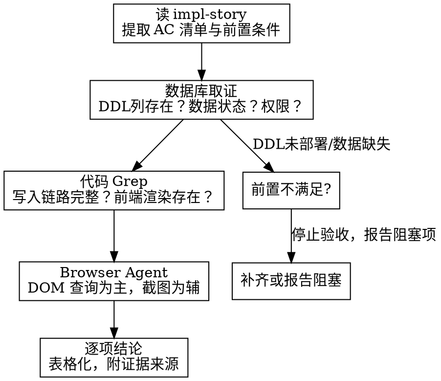

# 功能验收测试

## 概述

**核心原则：** 证据链驱动——每条验收项必须有数据库/代码/DOM 三方交叉证据，不凭截图或口头报告下结论。

**适用场景：** 任何需要在部署环境验证功能正确性的验收任务。测试用例来源不限：

| 输入来源 | 提取方式 |
|---------|----------|
| impl-story（实施计划） | 读 AC 清单与 TASK 交付落点 |
| PRD / Story 卡 | 读验收标准与场景描述 |
| 测试用例文档 | 读测试步骤与预期结果 |
| 口头描述 / Bug 报告 | 提炼为可验证的验收项 |
| 代码变更 diff | 从变更点反推验收项 |

## 何时使用

- 用户要求验证某个功能是否在测试环境生效
- 测试环境已部署最新代码，需要确认验收项是否通过
- 需要区分"代码正确但未部署"与"代码缺陷"
- 任何需要端到端验证的场景（新功能、Bug 修复、回归测试）

**不适用：** 单元测试编写、CI 流水线验证、纯代码审查

## 核心流程



## Phase 1：提取验收项与前置条件

**根据输入来源，提取验收项：**

### 从 impl-story / PRD 提取
1. **AC 清单**——每条 AC 的验收标准
2. **影响文件**——后端 Service/Mapper、前端 Vue/TS、DDL 脚本
3. **前置条件链**——功能生效需要满足的所有条件
4. **关键约束**——如"仅创建时写入""不回溯"等

### 从测试用例文档提取
1. **测试步骤**——每步操作与预期结果
2. **测试数据要求**——需要什么前置数据
3. **边界条件**——异常输入、空值、并发等

### 从口头描述 / Bug 报告提炼
1. **复现步骤**——将描述转化为可操作步骤
2. **预期行为**——明确"正确"应该是什么样
3. **验收标准**——拆分为可逐项验证的条目

**输出格式：**

```markdown
## 验收目标
- 来源: {impl-story / PRD / 测试用例 / 口头描述}
- 关联: {AITOP001-XXXX / Bug-XXXX / 无关联}
- 验收项数量: N 条

## 前置条件
1. DDL: xxx 表需有 yyy 列
2. 数据: 模板需配 charge_role
3. 权限: 用户需有 ppm_xxx 权限
4. 部署: 后端+前端均已发版
```

## Phase 2：数据库取证

**目标：** 确认 DDL 已部署、数据状态满足前置条件。

**常用查询模式：**

```sql
-- 1. DDL 列存在性
DESCRIBE table_name;

-- 2. 数据状态
SELECT column_name FROM table_name WHERE condition LIMIT 10;

-- 3. 权限排查
SELECT * FROM project_staff_role WHERE application_id = 'xxx';

-- 4. 新增记录验证（按时间过滤部署后的数据）
SELECT * FROM table_name WHERE create_time >= '部署时间' ORDER BY create_time DESC LIMIT 20;
```

**关键原则：**
- 先确认 DDL 列存在，再查数据
- 存量数据天然为 NULL 不代表代码缺陷——必须按 `create_time` 过滤部署后的新增行
- 权限分两层：公司级 OSC 权限（`mockPermission.ts` 中 `companyPermissionsInfo`）vs 项目级角色（`project_staff_role` 表）

## Phase 3：代码链路 Grep

**目标：** 确认写入链路和读取链路代码完整。

**检查清单：**

| 链路类型 | Grep 目标 | 示例 |
|---------|----------|------|
| 写入链路 | Service 方法中的 set 调用 | `setRoleSource`, `setHeadStaffNo` |
| 持久化 | MyBatis XML 的 INSERT/UPDATE 列 | `role_source`, `test_leader` |
| 读取链路 | Mapper XML 的 SELECT 字段 | `role_source AS roleSource` |
| 前端渲染 | Vue 组件中的 class/title 引用 | `role-source-tag`, `测试负责人` |
| 变更对照 | 标签映射表 | `formFieldLabelMap`, `staffsFieldsCompare` |
| 路由/权限 | 路由 meta.permission | `permission: DELIVERABLE_REPO_LIST` |

**关键原则：**
- 写入和读取必须对称（INSERT 有 role_source，SELECT 也要有）
- 前端组件代码存在 ≠ 已部署（需 Phase 4 DOM 验证）
- 代码行号会漂移，用方法名/字段名 Grep 锚定

## Phase 4：浏览器 DOM 验证

**目标：** 在测试环境实际验证 UI 展示和数据。

**核心策略：JS 读取 DOM 为主，截图为辅。**

### 4.1 给 Browser Agent 的指令模板

```
当前用户：{用户名}({工号})
**策略：JS读取DOM为主，只在关键节点截1张图。**

## Step N: DOM 验证
用JS执行：
\```javascript
// 1. 关键字检查
const bodyText = document.body.innerText;
const checks = {
  hasFieldA: bodyText.includes('字段A'),
  hasFieldB: bodyText.includes('字段B')
};

// 2. 表单字段属性
const formItems = document.querySelectorAll('.ant-form-item');
const fieldAttrs = Array.from(formItems).filter(item => {
  const label = item.querySelector('.ant-form-item-label');
  return label && label.innerText.includes('目标字段');
}).map(item => ({
  label: item.querySelector('.ant-form-item-label').innerText.trim(),
  selectMode: item.querySelector('.ant-select')?.getAttribute('mode'),
  isRequired: item.querySelector('.ant-form-item-required') !== null,
  hasBpmIcon: item.innerHTML.includes('trigger')
}));

// 3. 表格数据
const tables = document.querySelectorAll('table');
// ... 提取行数据

return { checks, fieldAttrs };
\```
```

### 4.2 常用 DOM 查询模式

| 验证目标 | JS 查询 |
|---------|---------|
| 字段标签存在 | `document.body.innerText.includes('字段名')` |
| 表单必填标记 | `item.querySelector('.ant-form-item-required') !== null` |
| Select 多选模式 | `select.getAttribute('mode') === 'multiple'` |
| 自定义 class 元素 | `document.querySelectorAll('[class*="role-source"]')` |
| 单元格内 HTML 结构 | `cell.innerHTML.substring(0, 500)` |
| 按钮是否禁用 | `el.disabled \|\| el.getAttribute('disabled') !== null` |
| 页面错误提示 | `bodyText.includes('无权限') \|\| bodyText.includes('403')` |

### 4.3 截图策略

- **只在关键节点截 1 张**（编辑态全貌、保存成功提示等）
- 不要用截图替代 DOM 查询——截图慢且信息密度低
- 截图路径存到 `temp/` 目录，方便后续引用

## Phase 5：逐项结论

**输出格式：**

```markdown
## 验收结论

| # | 验收项 | 结果 | 证据 |
|---|--------|------|------|
| 1 | 只读态显示新字段 | ✅ PASS | DOM: 标签存在，值正确 |
| 2 | 编辑态属性正确 | ✅ PASS | DOM: mode=multiple, 非必填 |
| 3 | 直存生效 | ✅ PASS | DB: 字段值已写入 |
| 4 | 无BPM图标 | ✅ PASS | DOM: hasBpmIcon=false |
| 5 | 变更对照映射 | ✅ PASS | Code: formFieldLabelMap 已配置 |
| 6 | 数据库存储 | ✅ PASS | SQL: column=value 确认 |

**总评: N/N 项全部通过。**
```

**当输入来源无明确 AC 编号时**，用自然语言描述验收项即可，不必强套 AC-xxx 格式。

## 常见阻塞与应对

| 阻塞 | 根因 | 应对 |
|------|------|------|
| 页面报"无权限" | 公司级 OSC 权限 vs 项目级角色混淆 | 先查 `mockPermission.ts` 确认权限层级，再查对应配置源 |
| 按钮 disabled | 功能已迁移（如关卡编辑迁移到项目清单） | 读页面 alert 提示，找新入口 |
| DB 字段全为 NULL | 部署后未触发写入条件 | 按 create_time 过滤新增行，或补齐前置条件重新触发 |
| 前端看不到新列 | 前端未部署新包 | F12 在已加载 JS 中搜关键字确认部署版本 |
| 无法创建测试数据 | 表单必填校验/审批流程阻塞 | 用 API 直接调用后端接口创建数据 |

## 红线——停下来

- **不要凭"代码正确"就宣称功能通过**——必须看到 DOM/DB 实际证据
- **不要把"存量数据 NULL"当代码缺陷**——先确认部署后是否触发过写入
- **不要用截图替代 DOM 查询**——截图是补充证据，不是主证据
- **不要忽略权限分层**——公司级权限和项目级角色是两套独立体系
- **不要假设页面入口**——功能可能已迁移，先读页面提示

## 快速参考

| Phase | 工具 | 核心动作 | 产出 |
|-------|------|---------|------|
| 1. 提取验收项 | Read | 读输入文档/描述 | 验收清单 + 前置条件 |
| 2. 数据库取证 | database-mcp | DESCRIBE + SELECT | DDL 确认 + 数据状态 |
| 3. 代码链路 | Grep | 写入/读取/渲染 | 链路完整性确认 |
| 4. 浏览器验证 | Browser Agent | DOM 查询 + 截图 | UI 实际表现 |
| 5. 逐项结论 | 汇总 | 逐项对照 | 验收报告表格 |
